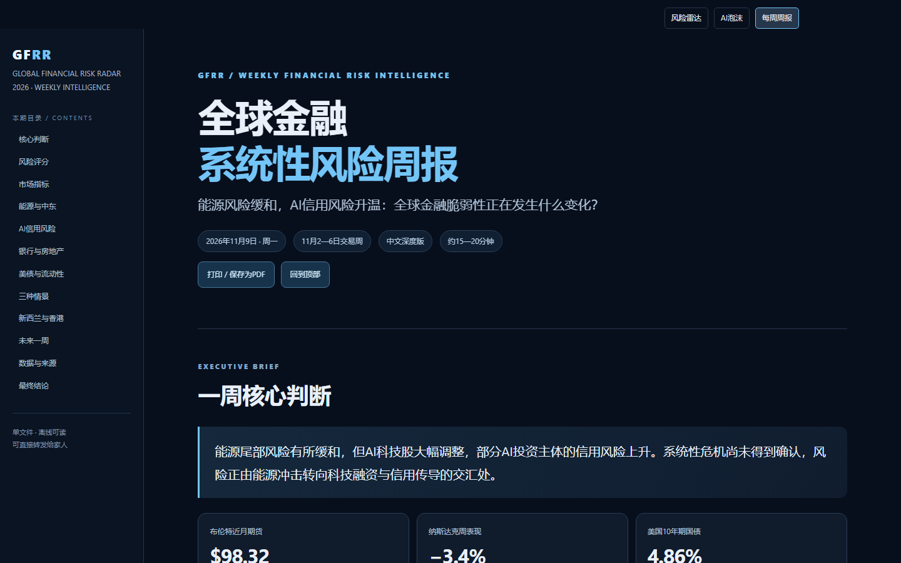
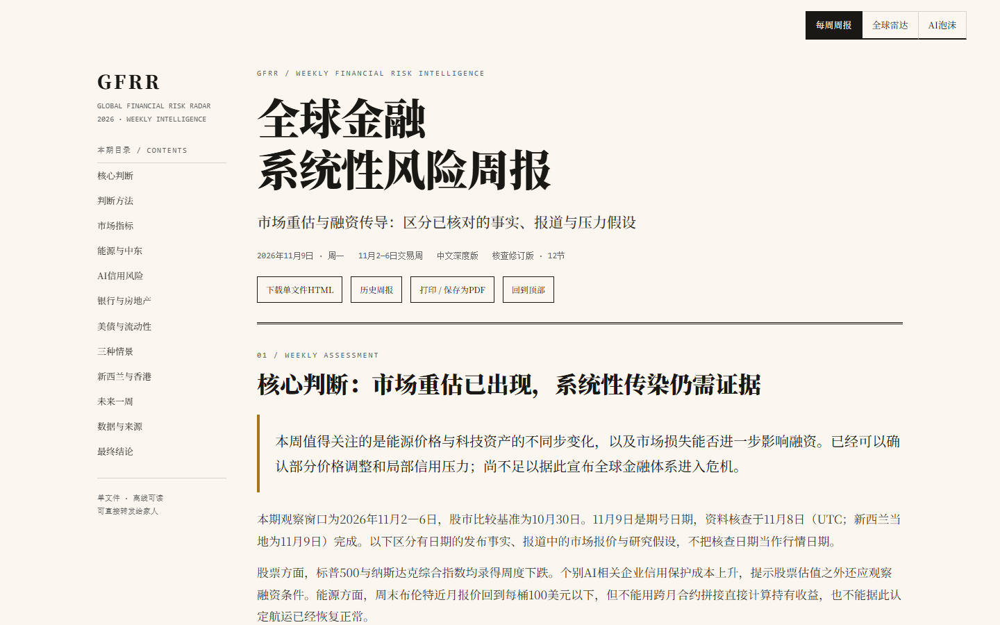
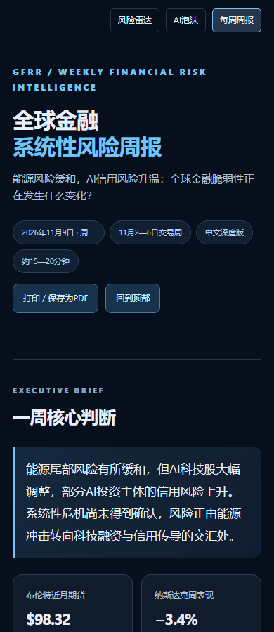
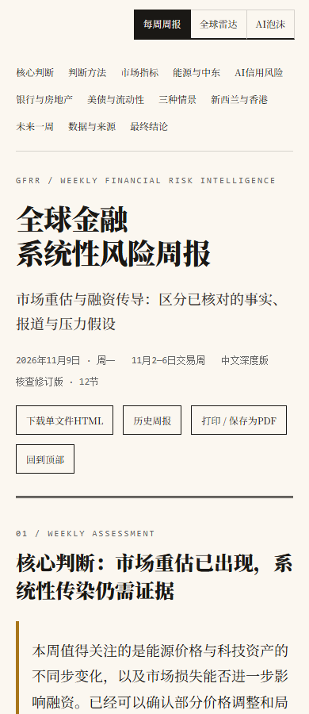

# 周报首页视觉验收 · 2026-11-09

本 PR 申请变更 DESIGN.md 的 §4.4 节，并以新增 §4.5 明确周报默认入口和右上三标签。雷达正文顺序、评分、生产数据及付费调用链未改变。

## 真实 Chromium 对比

改前来自 PR #510 原 head d850ec07 的实际HTML/CSS。改后来自本工作区实际构建，不是静态设计图。

- 桌面：1440 × 900，正文与三标签未溢出。
- 手机：390 × 900，三标签常显、正文单列，宽表在自身容器内横向滚动，不推宽全页。
- 周报背景由 rgb(8,15,28) 改为 rgb(251,247,240)，正文使用 Noto Serif SC / Source Han Serif SC / Songti SC / serif，标题使用 display token；无新增圆角卡片、阴影或蓝色装饰。
- 原雷达与AI泡沫的背景、字体和内容不变，仅将收缩丝带改为常显的三个标签。
- 实测根入口、三标签循环、浏览器前进/后退、旧雷达锚点、旧周报路径、历史按钮、单HTML下载和离线正文。

### 桌面改前

### 桌面改后

### 手机改前

### 手机改后

## 检查范围

- check:changed 自动选择完整 check:all，通过。
- 完整浏览器回归102项通过；周报6项单元回归通过。
- 单元覆盖门槛通过：1600项通过，1项平台条件跳过，0失败。
- 三套CSP/staging专项66项通过，Windows无法创建file symlink的1项按既有条件跳过，目录junction负例通过。Linux CI仍运行原保护门槛。
- 本地Pages artifact及EdgeOne report-only staging验证通过；严格CSP集合断言未改。
- 独立代码审查无剩余P1/P2；不等同于重新逐条审计所有外部报价。
- 原稿12节核查修订，不宣称恢复未取得的14章原文。具体来源与尚未核验范围在日期正文中保留。

这些是本地证据；远端CI与两站生产发布需另以实际结果验收。
