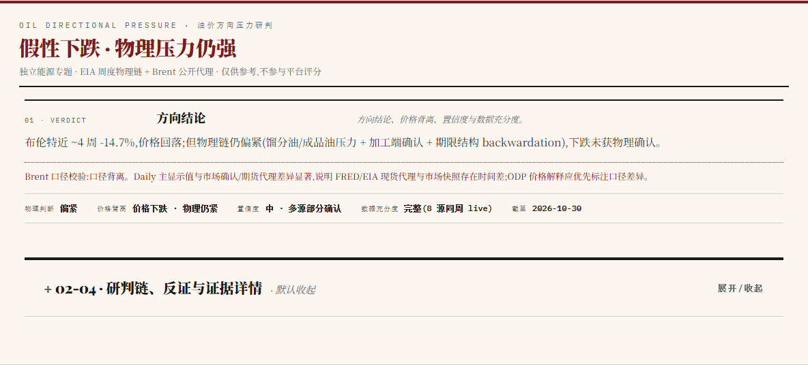
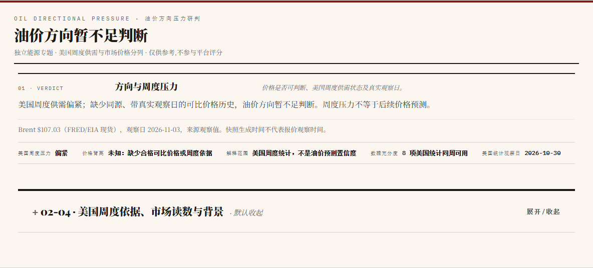
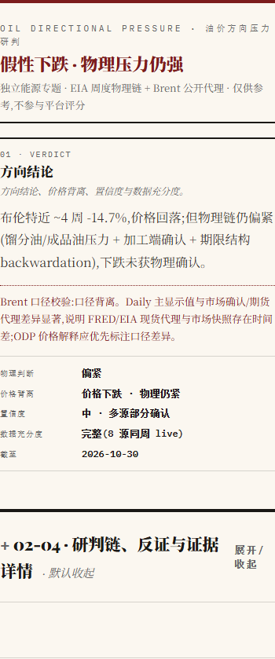

# PR #504: actual browser comparison

Captured 2026-11-07T17:41:43.457Z with fresh Chromium at 1440px and 390px.

- Before: main `7d8f21084289cae7277977186109bfbcf94cb34c`.
- After: #504 code at `1c5c122b6f36eb8a08b26824941e8f9d785c965e`, integrated with that main; runtime tree `266ec497ebd4819c7f48fccb6f0debd6c4c287d1`.
- Same `radar-data.json` and `oil-directional-pressure.json` bytes in both views. Hashes and actual computed styles are in [the browser receipt](visual-receipt.json).
- All four views have no horizontal overflow, page errors or console errors. The ODP fold opened and closed twice in each view.
- Warm paper background `rgb(251, 247, 240)`, ink `rgb(26, 24, 21)`, existing serif/display font stacks, no radius or shadow.
- These are local browser observations, not a claim of production deployment or human code approval.

## Desktop 1440px

Before:

After:

## Mobile 390px

Before:

After:

