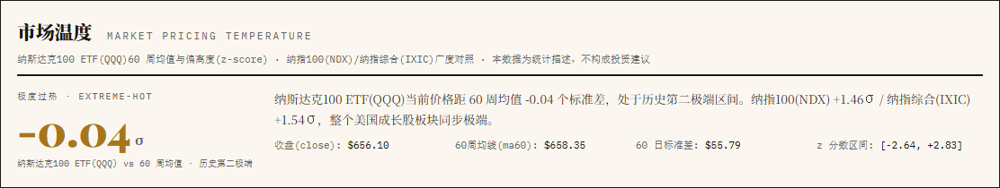
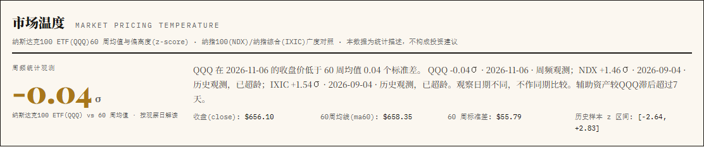
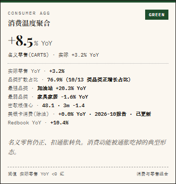
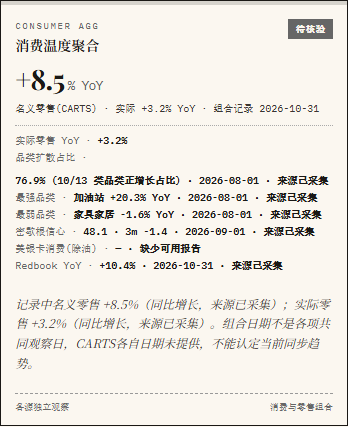
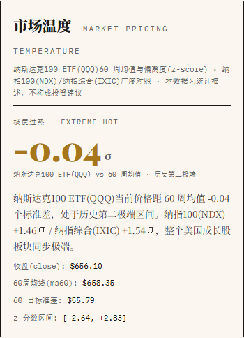
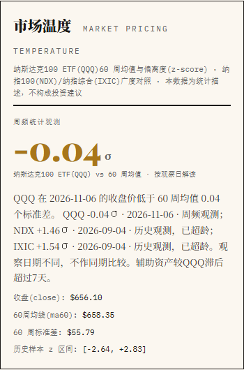
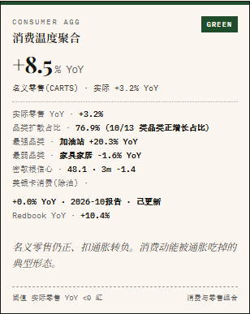
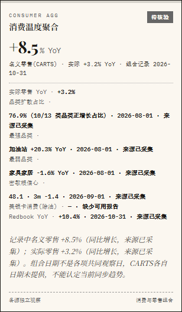

# PR #505: actual browser comparison

Captured 2026-11-07T17:54:29Z with fresh Chromium at 1440px and 390px.

- Before: #504 candidate `0f4d8dde747064f55b29cdfa85685121162ddc75`, with the same tree as released main `4495f4b3a81e27b480c994f10902bf6192ae6566`.
- After: readout integration `611da4cb80ee7549843d24bb2a2b294ae35d5e57`, tree `3f4871a1f2f82fd35523c16743274ebf79000029`. The capture preceded the commit; no runtime files changed between them.
- Same radar, oil-directional and market-pricing JSON bytes in both views. Hashes and actual computed styles are in [the browser receipt](visual-receipt.json).
- All four views have no horizontal overflow, page errors or console errors. The professional-evidence fold opened and closed twice, followed by two reloads at each width.
- Existing warm-paper, serif/display/mono styles are preserved. No CSS, layout, source collection or scoring change is introduced by this PR.
- Market temperature now identifies actual per-asset dates and stale/unsynchronized auxiliary evidence. Consumer details distinguish missing BoA reports from genuine zero and retain each source date.
- The initial local integration attempt failed because a conflict-processing script truncated files. That attempt was discarded from acceptance, reconstructed from the three original Git blobs and fully revalidated. Its local failure log is retained. No failed candidate was pushed.
- Independent review was performed by an AI reviewer, not a human reviewer; no GitHub approval was submitted. These captures are local observations, not proof of production deployment or refreshed source data.

## 1440px

### Market temperature

Before:

After:

### Consumer evidence

Before:

After:

## 390px

### Market temperature

Before:

After:

### Consumer evidence

Before:

After:

